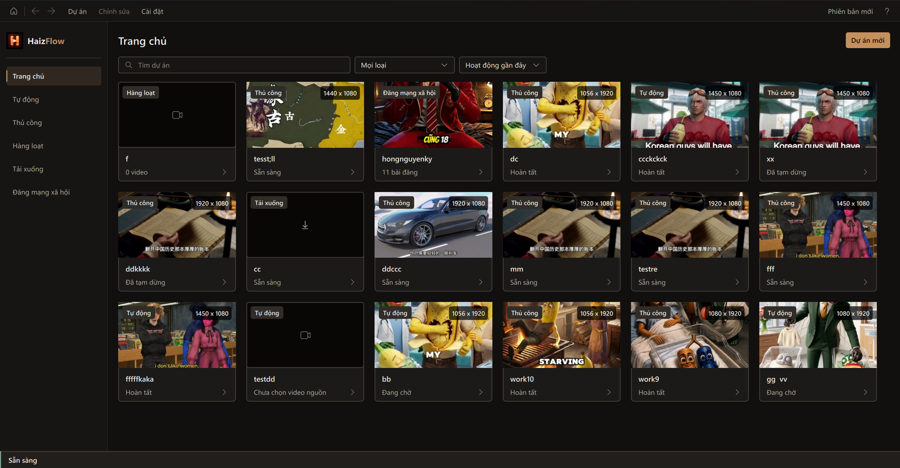
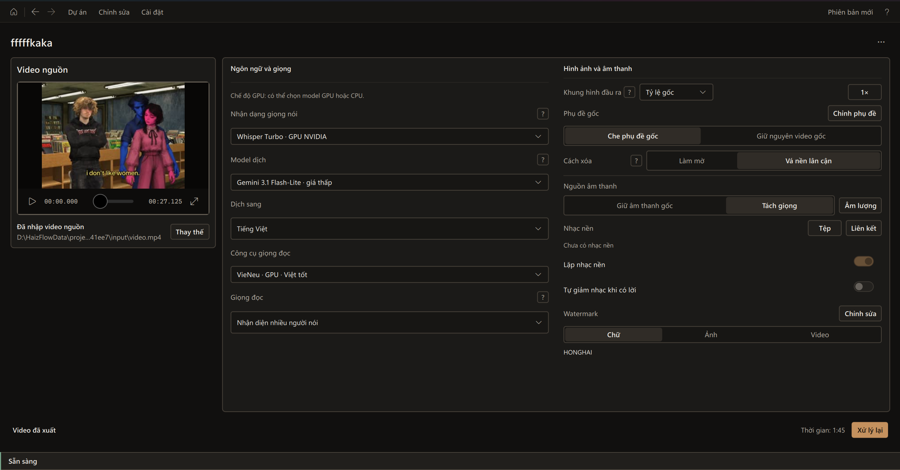
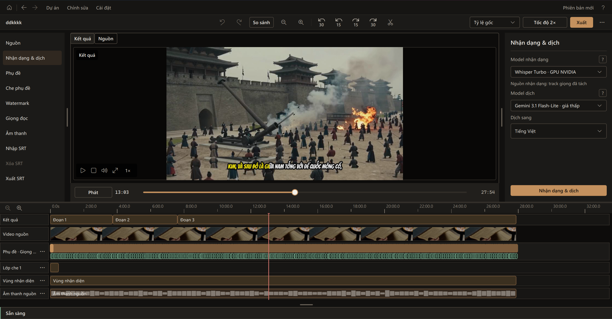
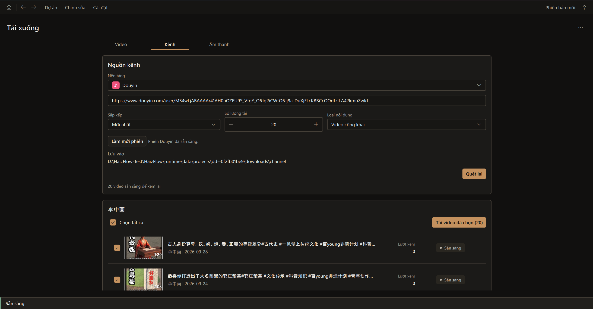
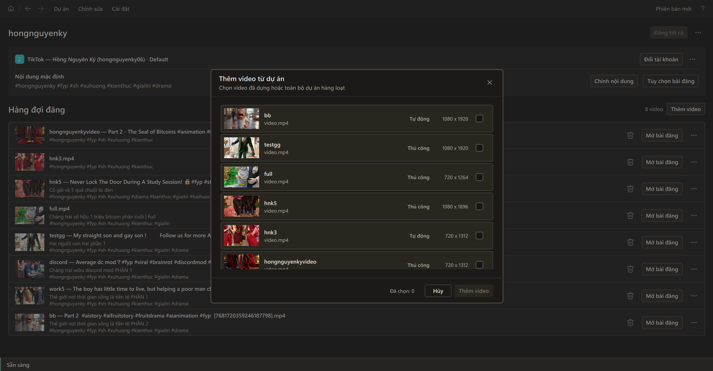
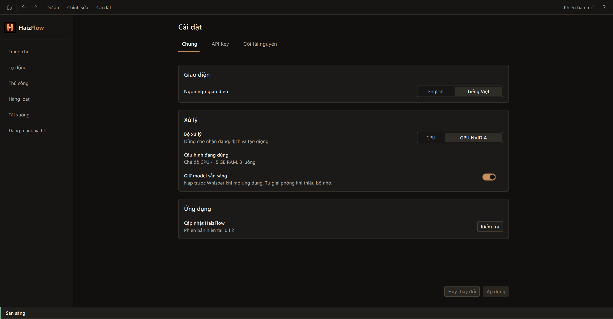

<div align="center">
  
  <h1>videoFlow (HaizFlow Edition)</h1>
  <p><strong>A comprehensive Windows desktop application for downloading, translating, subtitling, dubbing, automated daily news broadcasting, and AI story/article-to-video generation.</strong></p>
  <p><a href="https://github.com/thaipeace/videoFlow">GitHub Repository</a> · <a href="docs/user-guide.md">User Guide</a> · <a href="docs/support.md">Help</a> · <a href="README.vi.md">Tiếng Việt</a></p>
</div>

## About videoFlow

**videoFlow** (built upon the open HaizFlow core) is an end-to-end automated video creation and localization platform for Windows. It provides a complete workflow from offline speech translation, subtitle generation, and multi-speaker voice dubbing to **fully autonomous daily news production** and **AI-powered novel/article-to-video cinema creation**.

The application offers flexible workflows:
- **Automatic & Batch Processing:** Process single or multiple videos in queues with local offline AI models (Whisper, HY-MT2) or cloud engines (Gemini Flash).
- **Manual Editor:** Review and fine-tune subtitles, segment timestamps, audio timelines, and voice synthesis before exporting.
- **Automated Daily News:** Completely autonomous news pipeline from RSS collection, AI editorial synthesis, and TV-broadcast motion graphics to scheduled YouTube publishing.
- **AI Story & Article-to-Video:** Turn raw text, fiction novels, or journalism into narrated videos with consistent 2D character presets, Ken Burns camera motion, and customizable visual styles.

---

## Main Features

| Feature | Capabilities |
| --- | --- |
| 📰 **Automated Daily News (New)** | Multi-region independent RSS ingestion, Gemini editorial synthesis, TV-grade broadcast styling (scrolling ticker bar, channel logo, 3D intro globe, CTA overlay), and background Windows Task Scheduler triggers for direct YouTube publishing. |
| 📖 **AI Story / Article-to-Video (New)** | Convert articles, web novels, and short stories into cinematic videos with expressive narration, AI story director scene scoring, 2D character appearance consistency, and smooth Ken Burns motion. |
| **Video Translation** | Speech recognition with Whisper; local offline translation with HY-MT2 or online with Gemini Flash. Full review before export. |
| **Subtitles & Karaoke** | Extract captions from audio; customize timing, Bangers font styling, and vibrant karaoke word-highlight animations. |
| **Voice Dubbing & Cloning** | Natural voiceover using Edge-TTS, VieNeu, or OmniVoice voice cloning from reference audio samples. |
| **Automatic & Batch Pipelines** | Apply unified configurations across queues with automated recognition, translation, dubbing, and caption overlay. |
| **Subtitle Inpainting (OCR)** | Detect hardcoded burned-in subtitles via OCR and conceal them using intelligent blur or background patching. |
| **Speaker Diarization** | Group speakers in multi-party dialogues and assign distinct voices to each persona. |
| **Batch Video Downloads** | Ingest public channels or video links (e.g. Douyin, YouTube) and queue downloads locally. |
| **Social Publishing** | Prepare titles, descriptions, and tags for multi-account publishing via Zernio or direct YouTube Data API OAuth2. |

---

## ✨ Flagship Feature: Automated Daily News Broadcast Pipeline

Run an automated 24/7 news channel with zero manual daily effort:

### 1. Three Timeslots — Four Daily Broadcasts
* **05:30 AM — Morning News (`tin_moi`, 16:9 Widescreen 1080p):** World News + Top European Football. International news broadcast style, rotating 3D globe intro, and classic Navy Blue `#17365D` identity.
* **11:30 AM — Midday Good News Shorts (`hope`, 9:16 Vertical):** Breakthrough science, medicine, green innovations, and heartwarming human stories (45–55s duration).
* **12:00 PM — Midday Viral Curiosities Shorts (`viral`, 9:16 Vertical):** Trending social oddities, comedy clips, and bizarre world occurrences.
* **05:30 PM — Evening Hot Briefing (`tin_nong`, 16:9 Widescreen 1080p):** War & Military Geopolitics + Breakthrough Technology / AI / Semiconductors. Tactical situation room radar style and Deep Red `#9F2028` theme.

### 2. Independent Multi-Feed Ingestion & Strict Content Filters
* **Separate Source Gathering:** Ingests World news from Reuters/AP/BBC/NPR/DW; Sports from BBC Sport/Sky Sports; War from ISW/Al Jazeera War; Tech from The Verge/TechCrunch. Each topic is fetched independently before AI synthesis to ensure peak informational depth.
* **0% Domestic Vietnam News Rule:** Strict geographic keyword filtering keeps bulletins focused purely on global affairs.
* **Strict War Filter:** Prevents entertainment, sports, or celebrity gossip from contaminating geopolitical warfare bulletins.
* **100% Football Focus for Sports:** Covers the Top 5 European leagues (Premier League, La Liga, Serie A, Bundesliga, Ligue 1), UEFA Champions League, superstar spotlights (Mbappé, Haaland, Messi, CR7), and regional ASEAN football.

### 3. Broadcast Graphics & Anti-Reused Content (YouTube YPP Ready)
* **Scene 0 Direct Hook:** Kicks off immediately with a dramatic 1–2 sentence hook; eliminates repetitive generic greetings.
* **News Ticker Strip:** Real-time bottom ticker scrolling summaries across the video with category badges.
* **Brand Assets:** Corner channel logo, subtle anti-scraping watermark, and animated Subscribe CTA card with sound effects.
* **7-Day Dynamic Thumbnail Palette:** Main hook title colors automatically shift according to the day of the week.

### 4. Headless Automation via Windows Task Scheduler
* Deep integration with Windows Task Scheduler using headless `pythonw.exe`.
* **Wake PC from Sleep:** Enables wake timers (`WakeToRun = True`, `powercfg RTCWAKE = 1`) so the machine wakes automatically to produce and publish the broadcast.
* Direct YouTube OAuth2 upload with automatic playlist assignment (`Bản tin thế giới`).
* One-click health check and repair harness: `python scripts/check_daily_news_harness.py --repair`.

---

## ✨ Flagship Feature: AI Story & Article-to-Video Generator

Turn any written story, light novel, or blog post into an illustrative animated video:

* **AI Story Director:** Analyzes narrative text, segments speech into natural phrasing, and computes emotional Visual Impact Scores (1–10) to determine optimal keyframe placement.
* **2D Character Presets & Consistency:** Bundled character library with fixed appearance prompt anchors (`prompt_anchor`) to preserve hairstyle, facial features, and attire across every illustrated scene.
* **Art Styles:** Choose from 2D Anime, Manhwa Webtoon, Watercolor, Cyberpunk, Comic, or Oil Painting styles via Google Imagen 3 API or local Stable Diffusion.
* **Ken Burns Cinematography:** Smooth pan and zoom camera transitions rendered via FFmpeg convert static illustrations into motion pictures.
* **Emotive Narration:** High-fidelity Vietnamese and international voice synthesis via Edge-TTS, VieNeu natural tone, or reference voice cloning.
* **Multi-Format Output:** Export in standard 16:9 widescreen or 9:16 vertical Shorts/Reels/TikTok formats.

---

## User Interface

[Home](#home) · [Automatic](#automatic-processing) · [Manual Editor](#manual-editor) · [Daily News](#daily-news) · [AI Story](#ai-story-generator) · [Downloads](#downloads) · [Social Publishing](#social-publishing) · [Settings](#settings)

### Home
Filter and manage existing projects or initiate new production sessions.


### Automatic Processing
Configure voice, translation, and recognition models alongside subtitle inpainting and audio mastering.


### Manual Editor
Compare source and target previews, inspect timeline segments, import SRTs, and edit subtitles frame-by-frame.


### Daily News (New)
Command center for automated daily bulletins: category switches, headline counts, script preview, schedule management, and direct YouTube upload status.

### AI Story Generator (New)
Workspace for novel adaptation: paste text, choose voices, select 2D character presets, configure illustration counts, and export video.

### Downloads
Inspect channel playlists (Douyin, YouTube, etc.) and queue video assets.


### Social Publishing
Prepare posts, tags, and accounts for scheduled social publishing.


### Settings
Manage GPU/CPU acceleration, API keys (Gemini, Zernio), and offline resource packs.


---

## Installation & Quick Start

### System Requirements
* Windows 10 (1809+) or Windows 11 x64.
* 16 GB RAM minimum.
* NVIDIA GPU (Optional): Minimum 4 GB VRAM for local CUDA-accelerated models.

### Developer Setup from Source
```powershell
# 1. Clone repository
git clone git@github.com:thaipeace/videoFlow.git
cd videoFlow

# 2. Setup Python 3.12+ virtual environment
python -m venv .venv
.venv\Scripts\activate

# 3. Install core dependencies
pip install -r requirements.txt

# 4. Launch Desktop Application
python haizflow_desktop.py
```

### Daily News CLI & Automation Controls
```powershell
# Run comprehensive diagnostic on schedules, keys, and YouTube connection
python scripts/check_daily_news_harness.py

# Auto-repair and register Windows Task Scheduler jobs
python scripts/check_daily_news_harness.py --repair

# Execute a quick test run with mock data
python scripts/run_daily_news.py --now --category tin_moi --quick-test
```

---

## License & Attribution

videoFlow builds upon the foundational architecture of the HaizFlow project created by **Mạch Hồng Hải (Mach Hong Hai)**, extending it with autonomous broadcast engineering and generative AI story pipelines.

* Source code is distributed under the original project's [LICENSE](LICENSE).
* OmniVoice models remain restricted to noncommercial usage under their respective licenses.
* Utilizes Qt/PySide (LGPL), FFmpeg (GPL/LGPL), Edge-TTS, and associated open-source packages. See [NOTICE](NOTICE) and [THIRD_PARTY_NOTICES.md](THIRD_PARTY_NOTICES.md).
