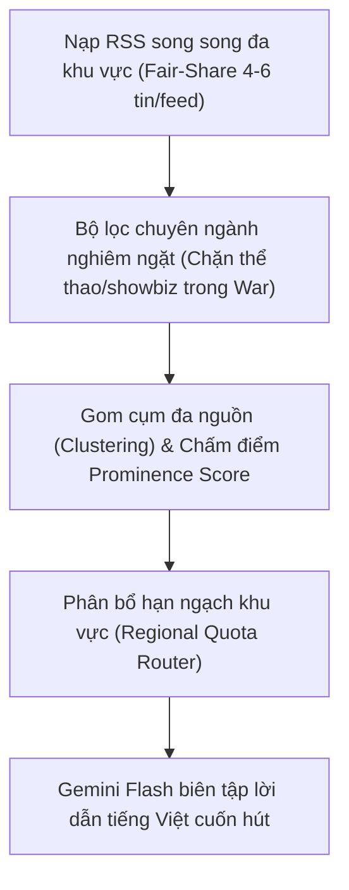

# 🚀 KẾ HOẠCH NÂNG CẤP TOÀN DIỆN HỆ THỐNG LẤY TIN HAIZFLOW
*(Cập nhật: 25/10/2026 - Áp dụng cho cả Video 16:9 Ngang và Video 9:16 Shorts)*

---

## 1. PHÂN TÍCH NGUYÊN NHÂN LỖI BẢN TIN CHIẾN SỰ HÔM NAY (25/10/2026)

Hôm nay bản tin **Chiến sự thế giới** đã xuất hiện các nội dung hoàn toàn không liên quan:
- **Tin thể thao**: Trận cầu Ngoại Hạng Anh giữa Arsenal, Man City, Tottenham và Chelsea (*Al Jazeera Sports*).
- **Tin đời tư/thời sự**: Bà Vanessa Trump thông báo khỏi bệnh ung thư vú (*BBC News*).
- Dẫn đến việc bản tin Chiến sự bị lẫn lộn chủ đề và **lặp lại các sự kiện** đã được đưa ở bản tin Thời sự và Thể thao trước đó.

### Nguyên nhân cốt lõi trong mã nguồn:
1. **Nguồn RSS dùng sai endpoint tổng hợp**:
   - `WAR_RSS_FEEDS` chứa link `"https://www.aljazeera.com/xml/rss/all.xml"`. Đây là feed **TẤT CẢ** chuyên mục của Al Jazeera, bao gồm cả bóng đá, kinh tế, lối sống.
2. **Thiếu hoàn toàn bộ lọc chuyên đề cho Chiến sự**:
   - Trong khi chuyên mục `sports` có hàm `is_non_football_news()`, chuyên mục `viral` có `is_mainstream_hard_news()`, thì chuyên mục `war` **hoàn toàn không có bất kỳ bộ lọc nào** (`is_war_conflict_news()`).
3. **Mô hình AI bị ép biên tập**:
   - Khi các tin bóng đá và đời tư lọt qua khâu RSS, chúng nằm trong danh sách gửi cho Gemini. Gemini bị buộc phải tạo phân cảnh thuyết minh cho Arsenal và Vanessa Trump ngay trong bản tin chiến sự!

---

## 2. GIẢI PHÁP KHẮC PHỤC TRIỆT ĐỂ BẢN TIN CHIẾN SỰ (`war`)

### A. Làm sạch nguồn RSS Chiến sự
- Loại bỏ ngay feed tổng hợp `/all.xml`.
- Thay bằng các feed chuyên sâu về chiến sự, an ninh quốc phòng, và điểm nóng xung đột:
  - Google News Conflict & Defense: `(war OR airstrike OR missile OR frontline OR combat OR clashes OR "military offensive" OR "peace talks") -sports -entertainment -vietnam`
  - Điểm nóng chiến sự trọng yếu:
    + **Nga - Ukraine & Châu Âu**: Mặt trận Donbass, Kursk, tập kích UAV, viện trợ quân sự NATO, an ninh Biển Đen.
    + **Trung Đông**: Dải Gaza, Bờ Tây, Lebanon/Hezbollah, Yemen/Houthi, Syria, Iran.
    + **Đông Á**: Căng thẳng eo biển Đài Loan, tập trận quanh bán đảo Triều Tiên, tranh chấp đảo Senkaku/Điếu Ngư.
    + **Đông Nam Á**: Nội chiến và xung đột thực địa tại Myanmar, an ninh biên giới khu vực.
    + **Châu Phi**: Nội chiến Sudan, xung đột Sahel.

### B. Xây dựng bộ lọc thép `is_strict_war_news()`
- Tự động **loại bỏ 100%**:
  - Mọi bài báo về bóng đá, thể thao, vận động viên, chuyển nhượng, giải đấu.
  - Mọi bài báo về giới nghệ sĩ, đời tư người nổi tiếng, chẩn đoán bệnh tật, phim ảnh.
  - Mọi bài báo kinh tế thuần túy (chứng khoán, lãi suất ngân hàng, bán lẻ).
- Bắt buộc bài viết phải chứa từ khóa thực địa chiến sự: quân đội, tập kích, tên lửa, chiến hào, phòng tuyến, thương vong, đàm phán ngừng bắn, vũ khí khí tài, bạo loạn vũ trang.

---

## 3. ĐỊNH HƯỚNG LẠI BẢN TIN BÓNG ĐÁ QUỐC TẾ (`sports`)

Bản tin Thể thao sẽ tập trung 100% vào **BÓNG ĐÁ ĐỈNH CAO & BÓNG ĐÁ KHU VỰC ĐƯỢC NGƯỜI VIỆT QUAN TÂM**, phân bổ rõ ràng theo 3 trục nội dung:

### Trục 1: 5 Giải Vô địch Quốc gia Hàng đầu Châu Âu & Cúp C1
- 🏴󠁧󠁢󠁥󠁮󠁧󠁿 **Ngoại Hạng Anh (Premier League)**: Man City, Arsenal, Liverpool, Man United, Chelsea, Tottenham, Newcastle...
- 🇮🇹 **Ý (Serie A)**: Inter Milan, Juventus, AC Milan, Napoli, AS Roma... Cuộc đua Scudetto, chiến thuật đỉnh cao phòng ngự - phản công.
- 🇩🇪 **Đức (Bundesliga)**: Bayern Munich, Borussia Dortmund, Bayer Leverkusen... Lối chơi rực lửa, kỷ lục ghi bàn của Harry Kane.
- 🇫🇷 **Pháp (Ligue 1)**: Paris Saint-Germain (PSG), Monaco, Marseille, Lyon...
- 🇪🇸 **Tây Ban Nha (La Liga)**: Real Madrid, Barcelona, Atletico Madrid... Siêu kinh điển El Clasico.
- 🏆 **UEFA Champions League (Cúp C1)** & Europa League.

### Trục 2: Câu chuyện Ngôi sao (Star Player Spotlight & Drama)
- Đi sâu vào các tên tuổi tạo sức hút lớn nhất hành tinh:
  - **Kylian Mbappé, Erling Haaland, Jude Bellingham, Vinícius Júnior, Lamine Yamal, Harry Kane, Mohamed Salah**.
  - **Lionel Messi & Cristiano Ronaldo** (kỷ lục, bàn thắng, phát biểu, tầm ảnh hưởng).
- Nội dung: Khoảnh khắc siêu phẩm, danh hiệu Quả Bóng Vàng (Ballon d'Or), drama phòng thay đồ, phát biểu nảy lửa của HLV (Guardiola, Arteta, Ancelotti...), các thương vụ "bom tấn" chuyển nhượng trăm triệu Euro.

### Trục 3: Bóng đá Láng giềng & Khu vực Người Việt Quan tâm Sát sao
*(Vẫn áp dụng triệt để Luật Tối thượng: 0% bóng đá Việt Nam - không đưa V-League, không đưa tuyển Việt Nam)*:
- 🇹🇭 **Bóng đá Thái Lan**: Đội tuyển Thái Lan ("Voi chiến"), diễn biến giải VĐQG Thai League, các ngôi sao Thái thi đấu ở nước ngoài, động thái HLV trưởng.
- 🇮🇩 **Bóng đá Indonesia**: Hiện tượng nhập tịch ồ ạt các cầu thủ gốc Hà Lan/Châu Âu, chiến dịch vòng loại World Cup khu vực châu Á, sự cuồng nhiệt cuồng nhiệt và biến động bóng đá xứ vạn đảo.
- 🇨🇳 **Bóng đá Trung Quốc**: Giải VĐQG Chinese Super League (CSL), cuộc khủng hoảng tài chính và chiến dịch thanh trừng tiêu cực, kết quả đội tuyển quốc gia Trung Quốc, sự đầu tư đào tạo trẻ.
- 🇰🇭 **Bóng đá Campuchia**: Sự chuyển mình của bóng đá trẻ Campuchia, các giải đấu cúp, HLV ngoại quốc, các trận giao hữu và tham vọng vươn lên ở khu vực Đông Nam Á.

---

## 4. NÂNG CẤP BẢN TIN SHORTS (9:16) VỚI CÁC NGUỒN KHU VỰC

Bản tin YouTube Shorts (9:16) gồm 2 dòng chủ lực cũng được tích hợp ngay nguồn tin Trung Quốc, Đông Nam Á, Nga, Nhật, Hàn:

### A. Shorts Tin lạ & Hài hước (`viral`) - 8 sự kiện / 45-55 giây
- **Trung Quốc**: Các trào lưu viral bùng nổ trên Douyin/Weibo, những phát minh độc dị hài hước, tình huống dở khóc dở cười tại các thành phố lớn và vùng nông thôn Trung Quốc.
- **Đông Nam Á**: Các clip hài hước thương hiệu Thái Lan, tình huống động vật hoang dã oái oăm (trăn khổng lồ, kỳ đà vào nhà dân) tại Indonesia, Malaysia, Philippines.
- **Nga & Siberia**: Sự kỳ lạ của vùng đất băng giá âm 50 độ, hố sụt permafrost, các hiện tượng thiên nhiên cực đoan và phong cách xử lý "bá đạo" của người Nga.
- **Nhật Bản & Hàn Quốc**: Trào lưu văn phòng, sáng tạo đường phố, lễ hội kỳ lạ.
- **Âu - Mỹ**: Florida Man, trộm vụng về bị camera ghi lại, động vật tấu hài Comedy Wildlife.

### B. Shorts Tin vui & Đột phá Sáng chế (`hope`) - 7 sự kiện / 45-55 giây
- **Trung Quốc**: Đại công trình Vạn Lý Trường Thành xanh phủ xanh sa mạc Kubuqi, trang trại điện mặt trời nổi khổng lồ, bước tiến robot hình người và lò phản ứng nhiệt hạch nhân tạo (EAST).
- **Nhật Bản & Hàn Quốc**: Thành tựu y học tái tạo tế bào gốc iPS chữa bệnh nan y, pin năng lượng thể rắn, tàu đệm từ Maglev siêu tốc, công nghệ làm sạch rác đại dương.
- **Đông Nam Á**: Dự án hồi sinh rạn san hô, năng lượng địa nhiệt Indonesia, sáng chế nông nghiệp tuần hoàn Thái Lan.
- **Toàn cầu**: Đột phá vắc-xin, thuốc chữa ung thư, năng lượng nhiệt thạch, máy lọc nước đại dương.

---

## 5. THUẬT TOÁN CHỌN TIN NỔI BẬT & PHÂN BỔ HẠN NGẠCH KHU VỰC

### Quy trình 3 bước xử lý:


1. **Bước 1: Nạp tin Fair-Share**: Gửi request song song tới ~15-20 feed nguồn, lấy 4-6 tin tiêu biểu nhất mỗi feed (khoảng 80-100 tin thô) mà không bị `break` ngắt sớm.
2. **Bước 2: Gom cụm & Chấm điểm nổi bật (Prominence Score)**:
   - Điểm số = $(Số\_nguồn\_cùng\_đưa \times 3) + (Điểm\_từ\_khóa\_nóng) + (Vị\_trí\_trang\_nhất)$.
   - Sự kiện nào được nhiều hãng tin lớn cùng đăng tải sẽ có điểm số cao nhất (sự kiện chấn động).
3. **Bước 3: Phân bổ Hạn ngạch (Quota Balancing)**:
   - **Bản tin Thời sự 8 sự kiện**:
     - 4 sự kiện (50%): Trung Quốc, Đông Nam Á (ASEAN), Nga, Nhật Bản, Hàn Quốc.
     - 4 sự kiện (50%): Điểm nóng Âu - Mỹ, Trung Đông, xung đột toàn cầu.
   - **Bản tin Chiến sự 8 sự kiện**:
     - 4 sự kiện: Trung Đông (Gaza, Lebanon, Red Sea) & Châu Phi/Mỹ Latinh.
     - 4 sự kiện: Chiến trường Nga - Ukraine & Điểm nóng quân sự Châu Á (Triều Tiên, Đài Loan, Myanmar).
   - **Bản tin Thể thao 8 sự kiện**:
     - 4 sự kiện: Ngoại Hạng Anh, Serie A (Ý), Bundesliga (Đức), Ligue 1 (Pháp), Champions League.
     - 2 sự kiện: Câu chuyện Ngôi sao (Mbappe, Haaland, Bellingham, Vinicius, Messi, Ronaldo).
     - 2 sự kiện: Bóng đá Đông Nam Á & Châu Á (Thái Lan, Indo, Trung Quốc, Campuchia).
   - **Bản tin Shorts (Viral & Hope)**: Tối thiểu 3-4 sự kiện/phân cảnh bắt nguồn từ Châu Á và láng giềng.

---

## 6. LỘ TRÌNH THỰC HIỆN KỸ THUẬT

1. **Cập nhật Feed Config & Bộ lọc trong `daily_news.py`**:
   - Thay thế/bổ sung các danh sách RSS: `WORLD_RSS_FEEDS`, `WAR_RSS_FEEDS`, `SPORTS_RSS_FEEDS`, `VIRAL_RSS_FEEDS`, `HOPE_RSS_FEEDS`.
   - Viết hàm `is_strict_war_news()` loại bỏ 100% tin thể thao/đời tư ra khỏi pipeline Chiến sự.
   - Viết hàm bổ sung từ khóa bóng đá Ý, Đức, Pháp, Thái Lan, Indo, Trung Quốc, Campuchia cho `is_football_news()`.
2. **Sửa đổi vòng lặp nạp tin trong `fetch_world_news_rss()`**:
   - Xóa bỏ `if len(raw_items) >= max(35, ...): break`.
   - Áp dụng fair-share quota cho từng feed.
3. **Nâng cấp thuật toán `cluster_and_rank_news_topics()`**:
   - Bổ sung bộ phân loại nhãn khu vực `detect_news_region(item)`.
   - Áp dụng thuật toán cân đối hạn ngạch theo bảng tỷ lệ ở Mục 5.
4. **Cập nhật Prompt cho Gemini Flash**:
   - Thêm quy định rõ ràng cho từng chuyên mục:
     + Chuyên mục Chiến sự: 100% quân sự, xung đột, bạo loạn an ninh; tuyệt đối cấm thể thao/đời tư.
     + Chuyên mục Thể thao: Bóng đá Anh, Ý, Đức, Pháp, Ngôi sao, Thái Lan, Indo, Trung Quốc, Campuchia.
     + Chuyên mục Shorts: Nhịp điệu 45-55s, hook mở đầu ấn tượng, đa dạng văn hóa Á - Âu.
5. **Chạy Test Suite & Kiểm chứng thực tế**:
   - Chạy test độc lập cho từng thể loại (`world`, `war`, `sports`, `viral`, `hope`) để kiểm tra danh sách tin đầu ra có đúng tỷ lệ và không bị lẫn lộn.

---

## 7. BỘ KHUNG QUY CHUẨN VẬN HÀNH & SỬA LỖI (OPERATIONAL HARNESS)

Toàn bộ cấu hình gốc, lịch trình tự động 6 chuyên mục, kết nối YouTube và cẩm nang sửa lỗi khẩn cấp đã được chuẩn hóa tại:
- 📖 **Tài liệu Harness chi tiết**: [`docs/extras/daily-news-automation-harness.vi.md`](file:///c:/projects/HaizFlow-main/docs/extras/daily-news-automation-harness.vi.md)
- 🛠️ **Công cụ chẩn đoán & tự động sửa lỗi 1-Click**:
  ```powershell
  # Kiểm tra sức khỏe toàn bộ luồng từ A - Z
  .venv\Scripts\python.exe scripts/check_daily_news_harness.py

  # Tự động sửa chữa khôi phục cấu hình và lịch biểu nếu phát hiện sai sót
  .venv\Scripts\python.exe scripts/check_daily_news_harness.py --repair
  ```

